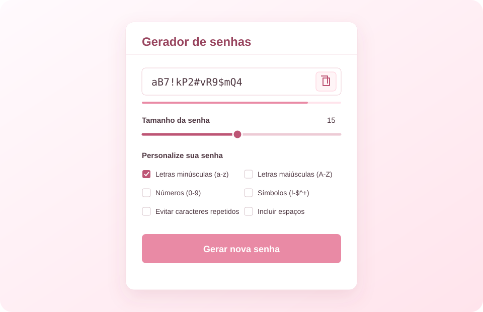

# Gerador de Senhas

Aplicação web simples para criar senhas personalizadas diretamente no navegador.

## Recursos

- Ajuste o tamanho da senha, de 1 a 30 caracteres.
- Escolha entre letras minúsculas, maiúsculas, números e símbolos.
- Ative opções para evitar caracteres repetidos ou incluir espaços.
- Copie a senha gerada com um clique.
- Indicador visual de força baseado no tamanho da senha.

## Como usar

Abra o arquivo `index.html` no navegador. Não é necessário instalar dependências.

## Tecnologias

HTML, CSS e JavaScript. A interface também utiliza Bootstrap e ícones Material Symbols via CDN.